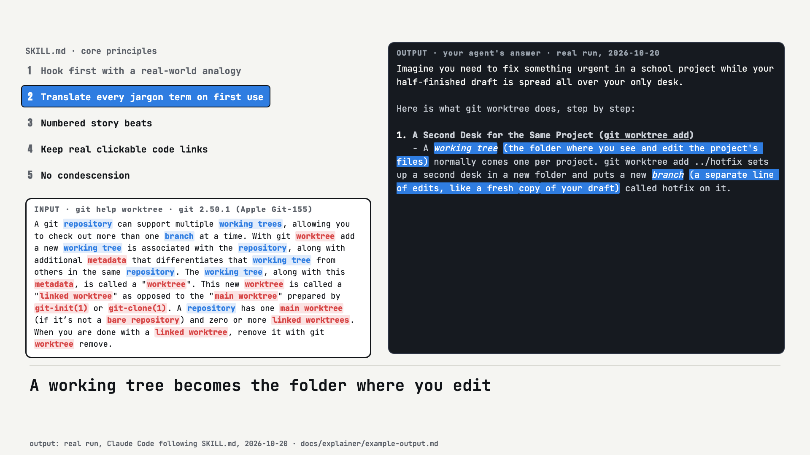

# Summarize Like I'm 12 (`summarize-like-im-12`)

**What it does, and for whom:** if you use an AI coding agent (such as Claude Code), this skill makes it explain code, papers, agent logs and diffs in plain words for a sharp 12-year-old, with everyday analogies and links to the real files. It is one instruction file (`SKILL.md`), not a separate program.

[](https://nojuannobody.github.io/summarize-like-im-12/explainer/explainer.mp4)

[▶ Watch the 70-second explainer](https://nojuannobody.github.io/summarize-like-im-12/explainer/explainer.mp4) · [Read the one-page explainer](https://nojuannobody.github.io/summarize-like-im-12/explainer/)

### How it works for you

1. Install the skill once: `npx skills add NoJuanNobody/summarize-like-im-12 -g`.
2. Ask your agent in plain words, for example "summarize like im 12" or `/eli12`, and point it at a file, diff, paper or log.
3. Your agent loads `SKILL.md` and follows its five rules: analogy first, every term translated, 3–5 numbered steps, real links, no talking down.
4. You get back a short story-style explanation that starts with "Imagine…" and links each part to its source. See a [real example run](docs/explainer/example-output.md).

> Note: `SKILL.md` also shows a `summarize-like-im-12 --input` command, but this repository contains no Python package or console entry point yet, so that command does not exist. Use the skill through your agent.

An Agent Skill that translates complex software architectures, multi-agent trajectories, research papers, and git diffs into vivid, jargon-free explanations aimed at a sharp 12-year-old—while preserving clickable links to every real file and repository.

## Installation

Install with [`npx skills`](https://skills.sh):

```bash
npx skills add NoJuanNobody/summarize-like-im-12 -g
```

## When It Triggers

- `"summarize like im 12"` / `"summary like im 12"`
- `"/summarize-like-im-12"` or `"/eli12"`
- `"explain this architecture simply"`

## What It Enforces

1. **Concrete Analogies**: Maps abstract primitives (worktrees, GraphRAG, Merkle DAGs, state channels) to everyday physical mechanisms (separate desks, spiderwebs of clues, digital wax seals, library printer coin slots).
2. **Zero Unexplained Jargon**: Every technical term is paired with an instant plain-English translation.
3. **True Technical Accuracy + Clickable Links**: Never hides the real files—links every concept directly to its source code or live URL.
